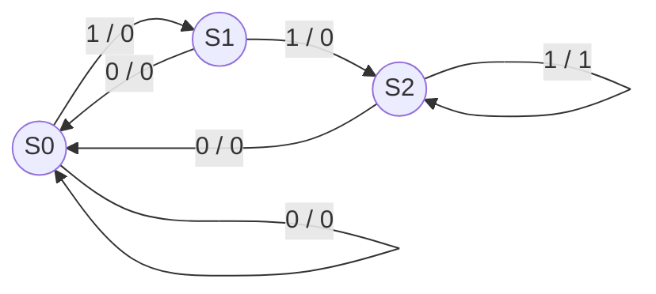
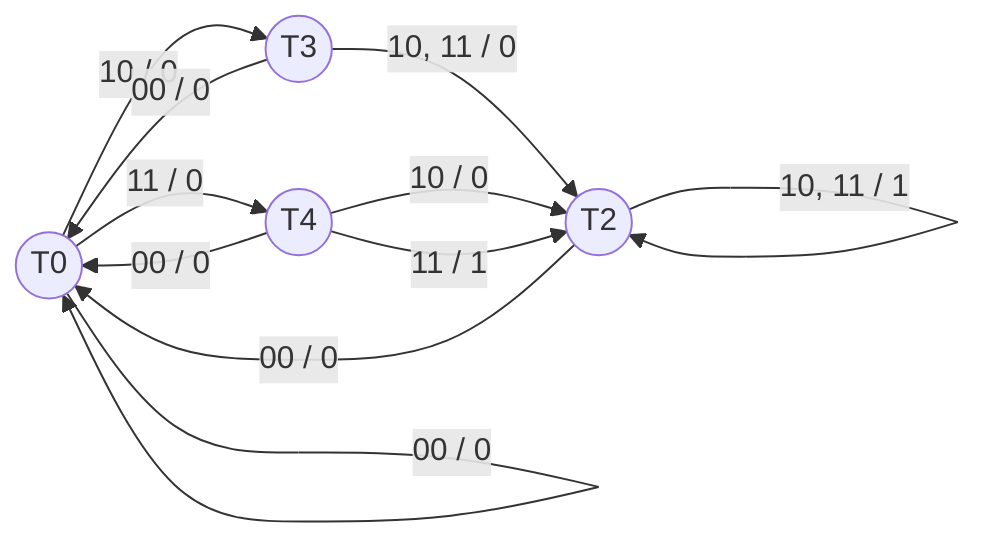

# 電気通信大学 情報理工学研究科 情報・ネットワーク工学専攻 2021年8月実施 選択問題 計算機の基本原理

## **Author**

祭音Myyura (co-authored with GPT 5.6 SOL)

## **Description**

あるレストランのテーブルには 4 人分の椅子 A, B, C, D があり、それぞれの椅子に取り付けられたセンサーによって着席の有無を一定時間毎に判定できるようになっている。ここで長時間の密な着席を判定するためのクロック同期式論理回路 $M,N$ をミーリーマシン（出力が現状態と入力によって決まる回路）として設計したい。

$a,b,c,d$ は入力用の論理変数で、対応する大文字の椅子に着席していた場合に 1、着席していない場合に 0 になる。$u,v$ は出力用の論理変数であり、$u$ は 3 人以上の着席が 3 回続いた時に限り 1 となり、$v$ は 3 人以上の着席が 3 回続くか 4 人の着席が 2 回続いた時に限り 1 となる。

$M$ は、入力として $a,b,c,d$ を、出力として $u$ をもつ順序回路である。$N$ は、入力として $a,b,c,d$ を、出力として $v$ をもつ順序回路である。

以下は 10 分毎のクロック周期に合わせて入力が変化した際の $M,N$ の動作の例を示したものである。

| 周期 $i$ | 0 | 1 | 2 | 3 | 4 | 5 | 6 | 7 | 8 | 9 | 10 | 11 | 12 | 13 | 14 | 15 | $\cdots$ |
|---|---|---|---|---|---|---|---|---|---|---|---|---|---|---|---|---|---|
| $a$ | 0 | 1 | 1 | 1 | 1 | 1 | 1 | 1 | 1 | 1 | 0 | 0 | 1 | 1 | 1 | 0 | $\cdots$ |
| $b$ | 0 | 0 | 0 | 0 | 1 | 1 | 1 | 1 | 1 | 1 | 1 | 1 | 1 | 1 | 1 | 1 | $\cdots$ |
| $c$ | 0 | 1 | 1 | 1 | 1 | 0 | 0 | 1 | 1 | 0 | 0 | 1 | 1 | 1 | 1 | 0 | $\cdots$ |
| $d$ | 0 | 0 | 1 | 1 | 0 | 1 | 0 | 1 | 1 | 1 | 1 | 1 | 1 | 0 | 1 | 0 | $\cdots$ |
| $u$ | 0 | 0 | 0 | 0 | 1 | 1 | 0 | 0 | 0 | 1 | 0 | 0 | 0 | 1 | 1 | 0 | $\cdots$ |
| $v$ | 0 | 0 | 0 | 0 | 1 | 1 | 0 | 0 | 1 | 1 | 0 | 0 | 0 | 1 | 1 | 0 | $\cdots$ |

**問 1.** $M$ の回路を組み合わせ回路 $M_1$ と順序回路 $M_2$ の二つに分けて設計する。$M_1$ は、$a,b,c,d$ を入力として $s$ を出力する。$s$ は $M$ の内部の中間的な論理変数であり、3 人以上が同時に着席している時に限り 1 となる。$M_2$ は、$s$ を入力して $u$ を出力する。

a）$s$ を $a,b,c,d$ の論理変数を用いた論理式で表せ。その際にはなるべく簡単な加法標準形（積和標準形）で書くこと。なお、論理和には $+$、論理積には $\cdot$、論理否定には $\bar{\phantom a}$ の記号を使うこと。

b）状態数が最小となるような $M_2$ の状態遷移図を書け。

c）問 1b）で求めた状態遷移図に対して状態割り当てを行い、次の状態 $(q'_0,q'_1,\ldots)$ と出力 $u$ を、現在の状態 $(q_0,q_1,\ldots)$ と中間変数 $s$ を用いた論理式で表せ。その際なるべく簡単な加法標準形を用いよ。

d）D 型フリップフロップと論理ゲートを用いて $M$ を構成せよ。D 型フリップフロップは入力 D、出力 Q を持ち、D に入力された値をその周期の間保持し、それを Q に出力するものとする。また論理ゲートは、AND, OR, NOT の三種類だけを用いて構成せよ。

**問 2.** $M$ と同様にして $N$ を設計したい。

a）状態数が最小となるような $N$ の状態遷移図を書け。その際中間変数を適宜定義して使ってもよい。

b）問 1d）と同様に、D 型フリップフロップと論理ゲートを用いて $N$ の回路を構成せよ。その際なるべく簡単な加法標準形を用いた論理式を求めた後に、AND, OR, NOT の三種類だけを用いた論理ゲートで構成すること。

クロック同期式論理回路：synchronous logic circuit、ミーリーマシン：Mealy machine、論理変数：logical variable、順序回路：sequential circuit、クロック周期：clock cycle、組み合わせ回路：combination circuit、順序回路：sequential circuit、論理式：logic equation、加法標準形：disjunctive normal form、論理和：OR、論理積：AND、論理否定：NOT、状態数：number of states、状態遷移図：state transition diagram、D 型フリップフロップ：D flip-flop、論理ゲート：logic gate。

### 题目描述

某餐厅的一张桌子有 A、B、C、D 四把椅子，每把椅子上的传感器都能每隔固定时间判断是否有人就座。为判定长时间密集就座，需要将时钟同步逻辑电路 $M,N$ 设计为 Mealy 机，即输出由当前状态和输入共同决定的电路。椅子布局及 $M,N$ 的结构见上方原图。

输入逻辑变量 $a,b,c,d$ 分别对应同名大写字母的椅子：有人就座时为 1，否则为 0。输出 $u$ 仅在连续 3 次都有至少 3 人就座时为 1；输出 $v$ 仅在连续 3 次至少 3 人就座，或连续 2 次 4 人全部就座时为 1。

$M$ 是以 $a,b,c,d$ 为输入、$u$ 为输出的时序电路，$N$ 是以 $a,b,c,d$ 为输入、$v$ 为输出的时序电路。上表给出了输入随每 10 分钟一次的时钟周期变化时，$M,N$ 的动作示例；表中 $i$ 表示周期，全部输入及输出值按表所示。

**问 1.** 将 $M$ 分为组合电路 $M_1$ 和时序电路 $M_2$ 来设计。$M_1$ 输入 $a,b,c,d$、输出中间逻辑变量 $s$；仅当至少 3 人同时就座时 $s=1$。$M_2$ 输入 $s$，输出 $u$。

a）用 $a,b,c,d$ 表示 $s$ 的逻辑式，尽量采用简洁的析取范式（积之和形式）。逻辑或、与、非分别用 $+$、$\cdot$ 和上横线表示。

b）画出状态数最少的 $M_2$ 状态转移图。

c）为问 1b）的状态转移图分配状态编码，用当前状态 $(q_0,q_1,\ldots)$ 及中间变量 $s$ 表示下一状态 $(q'_0,q'_1,\ldots)$ 与输出 $u$，尽量采用简洁的析取范式。

d）用 D 触发器和逻辑门构成 $M$。D 触发器有输入 D、输出 Q，在该周期内保持输入 D 的值，并从 Q 输出。逻辑门只能使用 AND、OR、NOT 三类。

**问 2.** 仿照 $M$ 设计 $N$。

a）画出状态数最少的 $N$ 状态转移图，可以适当定义并使用中间变量。

b）与问 1d）相同，用 D 触发器和逻辑门构成 $N$。先求尽量简洁的析取范式逻辑表达式，再仅用 AND、OR、NOT 三类逻辑门实现。

## **Kai**

### 問1

#### (a)

3 人以上が着席する条件は

$$
\boxed{s=abc+abd+acd+bcd}.
$$

#### (b)

$S_0,S_1,S_2$ を、それぞれ「末尾の連続した $s=1$ が 0 回、1 回、2 回以上」とする。遷移表は次のとおりである。表中は「次状態 / 出力」である。

| 現状態 | $s=0$ | $s=1$ |
|---|---|---|
| $S_0$ | $S_0/0$ | $S_1/0$ |
| $S_1$ | $S_0/0$ | $S_2/0$ |
| $S_2$ | $S_0/0$ | $S_2/1$ |

状態遷移図は次のとおりである。初期状態は $S_0$、辺の表示は「入力 / 出力」である。

三つの状態は、それぞれ今後 3 回、2 回、1 回の $s=1$ で初めて出力 1 となるため互いに区別でき、状態数は最小である。

#### (c)

状態を $(q_1,q_0)$ で

$$
S_0=00,\qquad S_1=01,\qquad S_2=11
$$

と割り当てる。このとき

$$
\boxed{q_0'=s,\qquad q_1'=sq_0,\qquad u=sq_1}.
$$

#### (d)

$M_1$ で (a) の $s$ を生成し、2 個の D 型フリップフロップに

$$
\boxed{D_0=s,\qquad D_1=sq_0}
$$

を入力する。出力ゲートを $u=sq_1$ とすればよい。いずれも AND, OR, NOT だけで構成できる。

### 問2

4 人全員が着席している条件を

$$
t=abcd
$$

とおく。$t=1$ なら必ず $s=1$ である。次の 4 状態を用いる。

- $T_0$：末尾の $s=1$ がない。
- $T_3$：直前が 3 人着席で、連続長は 1。
- $T_4$：直前が 4 人着席で、連続長は 1。
- $T_2$：$s=1$ が 2 回以上連続している。

可能な入力 $(s,t)=00,10,11$ に対する遷移は次のとおりである。

| 現状態 | $00$ | $10$ | $11$ |
|---|---|---|---|
| $T_0$ | $T_0/0$ | $T_3/0$ | $T_4/0$ |
| $T_3$ | $T_0/0$ | $T_2/0$ | $T_2/0$ |
| $T_4$ | $T_0/0$ | $T_2/0$ | $T_2/1$ |
| $T_2$ | $T_0/0$ | $T_2/1$ | $T_2/1$ |

状態遷移図は次のとおりである。初期状態は $T_0$、辺の表示は「$(s,t)$ / 出力」である。

$T_3$ と $T_4$ は次の入力 $11$ で区別でき、$T_0,T_2$ も必要な残り連続回数が異なるため、4 状態は最小である。

状態を

$$
\begin{gathered}
T_0=00,\\
T_3=01,\\
T_4=10,\\
T_2=11
\end{gathered}
$$

と割り当てると、加法標準形は

$$
\boxed{
\begin{aligned}
q_1'&=sq_1+sq_0+st,\\
q_0'&=sq_1+sq_0+s\bar t,\\
v&=q_1\bar q_0t+q_1q_0s.
\end{aligned}}
$$

したがって 2 個の D 型フリップフロップへ上式の $q_1',q_0'$ を入力し、同じく上式で $v$ を生成すれば、AND, OR, NOT ゲートだけで $N$ を構成できる。

## **Reference**

- [大学公表の原題](https://www.uec.ac.jp/education/graduate/admission/pdf/kako_i_choice202108.pdf)
