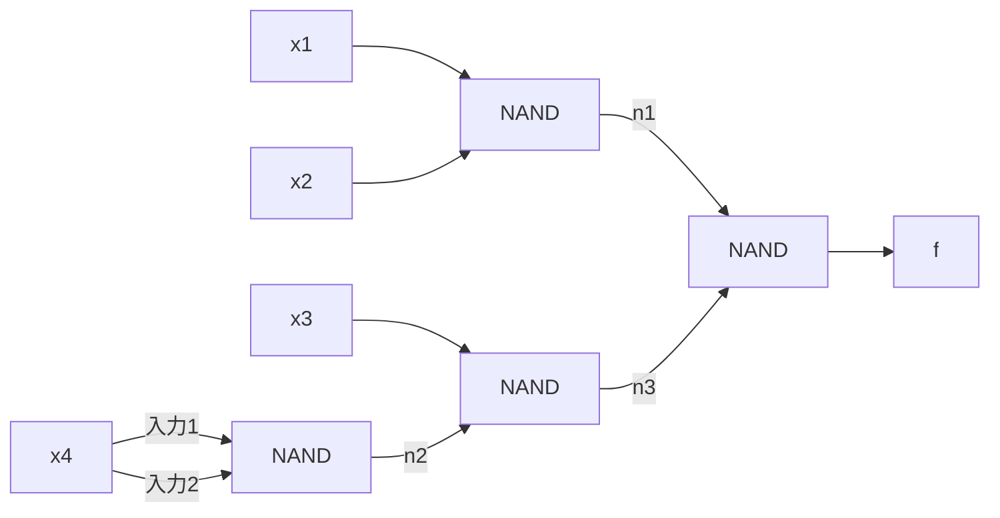

# 電気通信大学 情報理工学研究科 情報学専攻 2024年8月実施 選択問題 計算機工学 4-2

## **Author**

祭音Myyura (co-authored with GPT 5.6 SOL)

## **Description**

**1.** 以下の問いに答えよ。

（1）10 進数の 0.34375 を 2 進数で表せ。

（2）8 ビットの符号つき整数 $x$ を 2 の補数で表すとき、表現できる数値の範囲を 10 進数で書け。

（3）2100 個の漢字を同一のビット数で一意にコード化する際に、必要となる最小のビット数を答えよ。

（4）式（1）の論理式を変形し、最も簡単化された式を答えよ。$\bar x$ は $x$ の否定とする。

$$
x(y+z)(\bar x+\bar z)\tag{1}
$$

（5）式（2）の論理関数を実現する回路を 2 入力の NAND ゲートだけで構成し、その回路図を描け。$\bar x$ は $x$ の否定とする。

$$
f(x_1,x_2,x_3,x_4)=x_1x_2+x_3\bar x_4\tag{2}
$$

**2.** プログラム 1 は 5,000 個の浮動小数点命令と 25,000 個の整数命令で構成されている。プロセッサ A において、クロック周波数は 2.0 GHz。浮動小数点命令は 7 サイクル、整数命令は 1 サイクルを要する。以下の問いに答えよ。

（1）プロセッサ A がプログラム 1 を実行するのに必要な時間を答えよ。

（2）プログラム 1 に対するプロセッサ A の CPI を求めよ。

（3）プログラム 2 に対するプロセッサ A の CPI は 5 である。プログラム 2 における浮動小数点命令と整数命令の比率を求めよ。

**3.** バイトアドレッシング方式を採用したコンピュータ T はダイレクトマップ方式のキャッシュを使用している。主記憶の容量は 4 MB、キャッシュ容量は 4 KB、キャッシュブロックの大きさは 8 B である。以下の問いに答えよ。

（1）アドレスの内、キャッシュブロックを一意に指定するインデックスのビット数を求めよ。

（2）キャッシュが初期状態で空であると仮定し、メモリユニットから連続したアドレスに格納された 1001 バイトのデータをアドレス順に 1 バイトずつ読み出すプログラムを実行する場合、理由つきでヒット率を求めよ。

10 進数：decimal number、2 進数：binary number、ビット：bit、符号つき整数：signed integer、2 の補数：two's complement、一意：unique、コード化：encoding、論理式：logical expression、変形：transform、簡単化：simplification、否定：negation、論理関数：logical function、実現：implementation、プログラム：program、浮動小数点：floating-point、命令：instruction、整数：integer、クロック周波数：clock frequency、サイクル：cycle、CPI：cycles per instruction、バイトアドレッシング：byte addressing、ダイレクトマップ：direct-mapped、キャッシュ：cache、主記憶：main memory、容量：capacity、ブロック：block、アドレス：address、インデックス：index、初期状態：initial state、メモリユニット：memory unit、読み出す：read out。

### 题目描述

**1.** 回答下列问题。

（1）将十进制数 0.34375 表示为二进制数。

（2）用二进制补码表示 8 位有符号整数 $x$ 时，以十进制写出可表示的数值范围。

（3）将 2100 个汉字用相同位数进行唯一编码，至少需要多少位？

（4）变形式（1）的逻辑表达式，给出最简式。其中 $\bar x$ 表示 $x$ 的逻辑非。

$$
x(y+z)(\bar x+\bar z)
$$

（5）只用二输入 NAND 门实现式（2）的逻辑函数，并画出电路图。$\bar x$ 表示 $x$ 的逻辑非。

$$
f(x_1,x_2,x_3,x_4)=x_1x_2+x_3\bar x_4
$$

**2.** 程序 1 含 5,000 条浮点指令与 25,000 条整数指令。处理器 A 的时钟频率为 2.0 GHz，浮点指令耗时 7 个周期，整数指令耗时 1 个周期。回答：

（1）处理器 A 执行程序 1 需要多长时间？

（2）求处理器 A 执行程序 1 时的 CPI。

（3）处理器 A 执行程序 2 时 CPI 为 5，求程序 2 中浮点指令与整数指令的比例。

**3.** 按字节寻址的计算机 T 使用直接映射缓存。主存容量为 4 MB，缓存容量为 4 KB，缓存块大小为 8 B。回答：

（1）地址中用于唯一指定缓存块的索引占多少位？

（2）假设缓存初始为空，程序从内存单元中按地址顺序逐字节读取存放在连续地址中的 1001 字节数据。求命中率，并说明理由。

## **Kai**

### 問1

#### (1)

$$
0.34375=\frac{11}{32}
$$

より

$$
\boxed{(0.34375)_{10}=(0.01011)_2}.
$$

#### (2)

$$
\boxed{-128\leq x\leq127}.
$$

#### (3)

$2^{11}=2048<2100\leq4096=2^{12}$ より

$$
\boxed{12\text{ ビット}}.
$$

#### (4)

$$
x(y+z)(\bar x+\bar z)
=xy\bar z.
$$

したがって

$$
\boxed{xy\bar z}.
$$

#### (5)

次の 4 個の NAND を用いればよい。

$$
\begin{aligned}
n_1&=\operatorname{NAND}(x_1,x_2)=\overline{x_1x_2},\\
n_2&=\operatorname{NAND}(x_4,x_4)=\bar x_4,\\
n_3&=\operatorname{NAND}(x_3,n_2)=\overline{x_3\bar x_4},\\
f&=\operatorname{NAND}(n_1,n_3)=x_1x_2+x_3\bar x_4.
\end{aligned}
$$

### 問2

総サイクル数は

$$
5000\cdot7+25000\cdot1=60000
$$

である。よって

$$
\boxed{T=\frac{60000}{2.0\times10^9}=30\ \mu\mathrm{s}},
$$

$$
\boxed{\mathrm{CPI}=\frac{60000}{30000}=2}.
$$

プログラム 2 の浮動小数点命令数を $F$、整数命令数を $I$ とすると

$$
\frac{7F+I}{F+I}=5.
$$

したがって

$$
\boxed{F:I=2:1}.
$$

### 問3

キャッシュブロック数は

$$
\frac{4\ \mathrm{KB}}{8\ \mathrm{B}}=512=2^9
$$

なので、インデックスは

$$
\boxed{9\text{ ビット}}
$$

である。1001 B は、先頭のブロック内オフセットによらず 126 ブロックにまたがる。各ブロックの最初のアクセスだけがミスなので

$$
\boxed{\begin{gathered}
\text{ヒット率}=\frac{1001-126}{1001}\\
=\frac{875}{1001}\simeq87.4\%
\end{gathered}}.
$$

## **Reference**

- [大学公表の原題](https://www.uec.ac.jp/education/graduate/admission/pdf/kako_2_j_choice202408.pdf)
