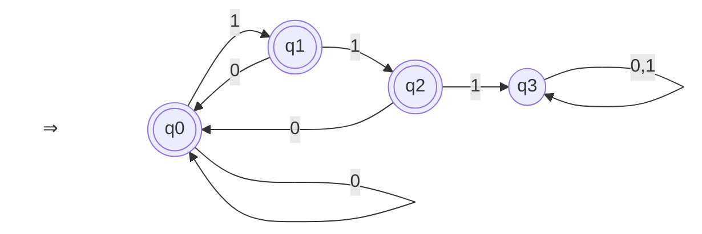

# 電気通信大学 情報理工学研究科 情報学専攻 2026年8月実施 選択問題 計算機工学

## **Author**

shank (co-authored with GPT 6.1 SOL)

## **Description**

### 問1

以下の問いに答えよ。

1. 8 進数の小数 $0.26$ を 10 進数の分数で表せ。
2. 32 ビットの符号なし整数 $x$ の上位 16 ビットと下位 16 ビットを入れ替えた値を $y$ とする。$y$ を $x$ の式で表せ。ただし，使用できる演算はビット OR $\lor$，ビット左論理シフト `<<`，およびビット右論理シフト `>>` のみとする。

### 問2

ある非パイプラインプロセッサ A は，1 命令を実行するのに $20\,\mathrm{ns}$ を要する。命令処理を高速化するために，このプロセッサ A の組み合わせ回路を $k$ ステージに均等分割したパイプラインプロセッサ B を設計した。各ステージ間にはパイプラインレジスタが挿入される。

#### (1)

$k=5$ のとき，プロセッサ B で $n$ 命令を連続で実行する場合の総実行時間を $n$ の式で表せ。ただし，パイプラインレジスタの遅延は無視できるものとし，パイプラインハザードも発生しないものとする。

#### (2)

実際には，パイプラインレジスタの遅延は無視できない。プロセッサ A の組み合わせ回路の総遅延時間を $D$，各ステージ間に挿入されるパイプラインレジスタ 1 個あたりの遅延を $r$ とする。この仮定で，プロセッサ B の 1 ステージの処理に必要な時間 $T(k)$ を $D,r,k$ を用いて表せ。

#### (3)

プロセッサ B が同期式回路として正しく動作するためのクロック周波数 $f_{\mathrm{clk}}(k)$ と $T(k)$ が満たすべき条件を不等式で示せ。

#### (4)

さらに，実際のプログラムでは実行時のデータハザードや分岐ハザードによってパイプラインストールが発生する。このため，プロセッサ B における CPI（cycles per instruction，あるいは clocks per instruction）は，ステージ数 $k$ を用いた以下のモデルに従っているものとする。

$$
\mathrm{CPI}(k)=1+0.125\cdot(k-4)\qquad(k\geq 4).
$$

なお，$D=16\,\mathrm{ns},\ r=1\,\mathrm{ns}$ のとき，$k$ ステージパイプラインで 1 命令を実行するのに要する最小の平均処理時間とそのときのステージ数 $k$ を求めよ。

問1：8 進数：octal number，小数：fractional number，10 進数：decimal number，分数：fraction，符号なし整数：unsigned integer，上位 16 ビット：upper 16 bits，下位 16 ビット：lower 16 bits，ビット OR：bitwise OR，左論理シフト：left logical shift，右論理シフト：right logical shift

問2：非パイプラインプロセッサ：non-pipelined processor，命令処理：instruction execution，組み合わせ回路：combinational circuit，ステージ：stage，均等分割：equal partitioning，パイプラインレジスタ：pipeline register，総実行時間：total execution time，遅延：delay，パイプラインハザード：pipeline hazard，総遅延：total delay，同期式回路：synchronous circuit，クロック周波数：clock frequency，不等式：inequality，データハザード：data hazard，分岐ハザード：branch hazard，ストール：stall，モデル：model，平均処理時間：average processing time

### 問3

$\Sigma=\{0,1\}$ とする。$\Sigma$ 上の言語 $L$ を，連続する 3 個以上の 1 を含まない記号列からなる集合とする。このとき，以下の問いに答えよ。

#### (1)

次の記号列のうち，$L$ に属するものをすべて書け。

```text
101, 111, 0110, 1110, 00111, 01011, 01111, 11010
```

#### (2)

$L$ を受理する状態数 4 の決定性有限オートマトンを $M=(Q,\Sigma,\delta,q_0,F)$ とする。ここで，$M$ の状態集合を $Q=\{q_0,q_1,q_2,q_3\}$ とし，状態遷移関数の一部を $\delta(q_0,1)=q_1,\ \delta(q_1,1)=q_2,\ \delta(q_2,1)=q_3$ とするとき，$M$ の状態遷移図を描け。その際，初期状態 $q_0$ を二重矢印（$\Rightarrow$）で指し，最終状態は二重丸（◎）で囲むこと。

#### (3)

$M$ の状態遷移関数 $\delta$ をすべて書け。また，$M$ の最終状態の集合 $F$ を書け。

### 問4

次の文脈自由文法 $G_1$ が与えられたとき，以下の問いに答えよ。

$$
\begin{aligned}
G_1&=(N,\Sigma,P,S) \\
&=\left(\{S,A,B\},\ \{a,b\},\ \{S\to aA,\ A\to aA,\ A\to SB,\ A\to b,\ B\to b\},\ S\right)
\end{aligned}
$$

ここで，$N$ は非終端記号の集合，$\Sigma$ は終端記号の集合，$P$ は生成規則の集合，$S$ は開始記号である。

#### (1)

$G_1$ が生成する終端記号列 $aaaabbb$ に対して，その導出木をすべて示せ。

#### (2)

$\Sigma$ 上の言語 $L_1$ を，$G_1$ が生成する言語 $L(G_1)$（すなわち，$L_1=L(G_1)$）とするとき，$L_1$ を $\{a^i b^j\mid i\geq 0,\ j\geq 0\}$ のような形で表記せよ。

#### (3)

$\Sigma$ 上の言語 $L_2$ を，$L_2=\{a^i b^j\mid j\geq i\geq 1\}$ とし，$L_3=L_1\cup L_2$（$L_3$ は $L_1$ と $L_2$ の和集合），$L_4=L_1\cap L_2$（$L_4$ は $L_1$ と $L_2$ の共通集合）とする。$L_3$ および $L_4$ を，(2) で示したような形でそれぞれ表記せよ。

#### (4)

$L_1,\ L_2,\ L_3,\ L_4$ のうち，正則言語であるものをすべて書け。ただし，いずれも正則言語でない場合は「なし」と書け。

問3：言語：language，連続する 3 個以上の 1：three or more consecutive 1's，記号列：string，受理：accept，状態数：number of states，決定性有限オートマトン：deterministic finite automaton，状態遷移関数：state transition function，状態遷移図：state transition diagram，初期状態：initial state，最終状態：final state

問4：文脈自由文法：context-free grammar，非終端記号：nonterminal symbol，終端記号：terminal symbol，生成規則：production，開始記号：start symbol，生成：generate，終端記号列：terminal string，導出木：derivation tree，和集合：union，共通集合：intersection，正則言語：regular language

### 题目描述

#### 问1

回答下列问题。

1. 将八进制小数 $0.26$ 表示为十进制分数。
2. 设 $x$ 是一个 32 位无符号整数，将其高 16 位和低 16 位互换后得到的值记为 $y$。用含 $x$ 的表达式表示 $y$。允许使用的运算仅为按位 OR $\lor$、逻辑左移 `<<` 和逻辑右移 `>>`。

#### 问2

某非流水线处理器 A 执行一条指令需要 $20\,\mathrm{ns}$。为加快指令处理，将处理器 A 的组合逻辑电路均匀划分为 $k$ 级，设计成流水线处理器 B。相邻各级之间均插入流水线寄存器。

**(1)**

当 $k=5$ 时，求处理器 B 连续执行 $n$ 条指令所需的总时间，用含 $n$ 的表达式表示。假设流水线寄存器的延迟可以忽略，且不会发生流水线冒险。

**(2)**

实际上，流水线寄存器的延迟不能忽略。设处理器 A 的组合逻辑电路总延迟为 $D$，各级之间插入的每个流水线寄存器的延迟为 $r$。在此假设下，用 $D,r,k$ 表示处理器 B 一级处理所需的时间 $T(k)$。

**(3)**

为使处理器 B 作为同步电路正确工作，时钟频率 $f_{\mathrm{clk}}(k)$ 与 $T(k)$ 应满足什么条件？用不等式表示。

**(4)**

实际程序运行时，还会因数据冒险和分支冒险产生流水线停顿。因此，假设处理器 B 的 CPI（cycles per instruction，或 clocks per instruction，即每条指令所需的时钟周期数）遵循如下关于级数 $k$ 的模型：

$$
\mathrm{CPI}(k)=1+0.125\cdot(k-4)\qquad(k\geq 4).
$$

当 $D=16\,\mathrm{ns},\ r=1\,\mathrm{ns}$ 时，求 $k$ 级流水线执行一条指令所需的最小平均处理时间，以及此时的级数 $k$。

问1术语：八进制数（octal number），小数（fractional number），十进制数（decimal number），分数（fraction），无符号整数（unsigned integer），高 16 位（upper 16 bits），低 16 位（lower 16 bits），按位 OR（bitwise OR），逻辑左移（left logical shift），逻辑右移（right logical shift）。

问2术语：非流水线处理器（non-pipelined processor），指令处理（instruction execution），组合逻辑电路（combinational circuit），级（stage），均匀划分（equal partitioning），流水线寄存器（pipeline register），总执行时间（total execution time），延迟（delay），流水线冒险（pipeline hazard），总延迟（total delay），同步电路（synchronous circuit），时钟频率（clock frequency），不等式（inequality），数据冒险（data hazard），分支冒险（branch hazard），停顿（stall），模型（model），平均处理时间（average processing time）。

#### 问3

设 $\Sigma=\{0,1\}$。语言 $L$ 是 $\Sigma$ 上所有不含连续 3 个或更多个 1 的字符串构成的集合。回答下列问题。

**(1)**

写出下列字符串中所有属于 $L$ 的字符串。

```text
101, 111, 0110, 1110, 00111, 01011, 01111, 11010
```

**(2)**

设接受 $L$ 的四状态确定性有限自动机为 $M=(Q,\Sigma,\delta,q_0,F)$，其状态集合为 $Q=\{q_0,q_1,q_2,q_3\}$，且部分状态转移函数为 $\delta(q_0,1)=q_1,\ \delta(q_1,1)=q_2,\ \delta(q_2,1)=q_3$。画出 $M$ 的状态转移图。绘图时，用双箭头（$\Rightarrow$）指向初始状态 $q_0$，并用双圆圈（◎）标出接受状态。

**(3)**

写出 $M$ 的全部状态转移函数 $\delta$，并写出 $M$ 的接受状态集合 $F$。

#### 问4

给定如下上下文无关文法 $G_1$，回答下列问题。

$$
\begin{aligned}
G_1&=(N,\Sigma,P,S) \\
&=\left(\{S,A,B\},\ \{a,b\},\ \{S\to aA,\ A\to aA,\ A\to SB,\ A\to b,\ B\to b\},\ S\right)
\end{aligned}
$$

其中，$N$ 为非终结符集合，$\Sigma$ 为终结符集合，$P$ 为产生式集合，$S$ 为开始符号。

**(1)**

对 $G_1$ 生成的终结符串 $aaaabbb$，画出其所有推导树。

**(2)**

设 $\Sigma$ 上的语言 $L_1$ 为 $G_1$ 生成的语言 $L(G_1)$，即 $L_1=L(G_1)$。用类似于 $\{a^i b^j\mid i\geq 0,\ j\geq 0\}$ 的集合形式表示 $L_1$。

**(3)**

设 $\Sigma$ 上的语言 $L_2=\{a^i b^j\mid j\geq i\geq 1\}$，$L_3=L_1\cup L_2$（$L_1$ 与 $L_2$ 的并集），$L_4=L_1\cap L_2$（$L_1$ 与 $L_2$ 的交集）。分别用 (2) 中的集合形式表示 $L_3$ 和 $L_4$。

**(4)**

写出 $L_1,\ L_2,\ L_3,\ L_4$ 中所有正则语言。若它们均不是正则语言，则写“无”。

问3术语：语言（language），连续 3 个或更多个 1（three or more consecutive 1's），字符串（string），接受（accept），状态数（number of states），确定性有限自动机（deterministic finite automaton），状态转移函数（state transition function），状态转移图（state transition diagram），初始状态（initial state），接受状态（final state）。

问4术语：上下文无关文法（context-free grammar），非终结符（nonterminal symbol），终结符（terminal symbol），产生式（production），开始符号（start symbol），生成（generate），终结符串（terminal string），推导树（derivation tree），并集（union），交集（intersection），正则语言（regular language）。

## **Kai**

### 問1

#### (1)

$$
(0.26)_8=\frac{2}{8}+\frac{6}{8^2}
=\frac{16+6}{64}=\boxed{\frac{11}{32}}.
$$

#### (2)

32 ビットの符号なし整数に対するシフト演算として，

```text
y = (x << 16) OR (x >> 16)
```

である。`x << 16` では元の上位 16 ビットが捨てられ，元の下位 16 ビットが上位に移る。`x >> 16` では元の上位 16 ビットが下位に移る。両者の非零となり得るビット位置は重ならないので，ビット OR により交換が完成する。

### 問2

#### (1)

各ステージの時間は $20/5=4\,\mathrm{ns}$ である。最初の命令は 5 サイクルで完了し，以後は毎サイクル一つずつ完了するので，総実行時間は

$$
\boxed{4(n+4)\,\mathrm{ns}}.
$$

#### (2)

組み合わせ回路の遅延 $D/k$ にレジスタの遅延 $r$ が加わるから，

$$
\boxed{T(k)=\frac{D}{k}+r}.
$$

#### (3)

クロック周期がステージの必要処理時間以上でなければならないので，

$$
\frac{1}{f_{\mathrm{clk}}(k)}\geq T(k),
\qquad
\boxed{0<f_{\mathrm{clk}}(k)\leq\frac{1}{T(k)}}.
$$

#### (4)

許される最大クロック周波数で動作させると，1 命令当たりの平均処理時間は

$$
\begin{aligned}
\tau(k)&=\mathrm{CPI}(k)T(k)\\
&=\frac{k+4}{8}\left(\frac{16}{k}+1\right)\,\mathrm{ns}\\
&=\left(\frac{5}{2}+\frac{k}{8}+\frac{8}{k}\right)\,\mathrm{ns}.
\end{aligned}
$$

相加相乗平均の不等式から

$$
\frac{k}{8}+\frac{8}{k}\geq2
$$

であり，等号は $k/8=8/k$，すなわち $k=8$ で成立する。これは $k\geq4$ を満たす整数なので，

$$
\boxed{k=8,\qquad\tau_{\min}=\frac92\,\mathrm{ns}=4.5\,\mathrm{ns}}.
$$

このとき $T(8)=3\,\mathrm{ns}$，$\mathrm{CPI}(8)=1.5$ である。

### 問3

#### (1)

連続する部分列 `111` を含まないものを選ぶと，

```text
101, 0110, 01011, 11010
```

である。

#### (2)

$q_0,q_1,q_2$ はそれぞれ，まだ `111` を含まず末尾の連続する `1` が 0 個，1 個，2 個である状態とする。$q_3$ は一度でも `111` が現れた状態であり，以後は受理しない。

以下では，`⇒` が初期状態を指し，二重丸が最終状態を表す。



#### (3)

全遷移と最終状態集合は次のとおりである。

| 状態 | 入力 $0$ | 入力 $1$ |
|---|---|---|
| $q_0$ | $q_0$ | $q_1$ |
| $q_1$ | $q_0$ | $q_2$ |
| $q_2$ | $q_0$ | $q_3$ |
| $q_3$ | $q_3$ | $q_3$ |

$$
\boxed{F=\{q_0,q_1,q_2\}}.
$$

### 問4

#### (1)

$A\to SB$ は，その後の $S\to aA$，$B\to b$ と合わせて $a$ と $b$ を一つずつ増やす。$A\to aA$ は $a$ だけを一つ増やす。最初の $S\to aA$ と最後の $A\to b$ から得られる $a,b$ を考慮すると，`aaaabbb` の導出には $A\to SB$ を 2 回，$A\to aA$ を 1 回使う必要がある。

これら三つの規則適用のうち $A\to aA$ の位置を選ぶ方法は 3 通りなので，導出木は次の 3 本で尽くされる。各木の葉を左から読むと `aaaabbb` となる。

**導出木 1：$A\to aA$ を最初に適用する。**

```text
S
├── a
└── A
    ├── a
    └── A
        ├── S
        │   ├── a
        │   └── A
        │       ├── S
        │       │   ├── a
        │       │   └── A
        │       │       └── b
        │       └── B
        │           └── b
        └── B
            └── b
```

**導出木 2：$A\to aA$ を二番目に適用する。**

```text
S
├── a
└── A
    ├── S
    │   ├── a
    │   └── A
    │       ├── a
    │       └── A
    │           ├── S
    │           │   ├── a
    │           │   └── A
    │           │       └── b
    │           └── B
    │               └── b
    └── B
        └── b
```

**導出木 3：$A\to aA$ を三番目に適用する。**

```text
S
├── a
└── A
    ├── S
    │   ├── a
    │   └── A
    │       ├── S
    │       │   ├── a
    │       │   └── A
    │       │       ├── a
    │       │       └── A
    │       │           └── b
    │       └── B
    │           └── b
    └── B
        └── b
```

#### (2)

$A\to aA$ の適用回数を $r\geq0$，$A\to SB$ の適用回数を $s\geq0$ とすると，生成される記号列は

$$
a^{1+r+s}b^{1+s}.
$$

したがって，必ず $i\geq j\geq1$ となる。逆に，任意の $i\geq j\geq1$ に対し $r=i-j$，$s=j-1$ と選べば $a^i b^j$ を生成できる。ゆえに

$$
\boxed{L_1=\{a^i b^j\mid i\geq j\geq1\}}.
$$

#### (3)

$i,j$ がともに正ならば $i\geq j$ または $j\geq i$ の少なくとも一方が成立し，両方が成立するのは $i=j$ のときである。よって

$$
\boxed{L_3=\{a^i b^j\mid i\geq1,\ j\geq1\}},
\qquad
\boxed{L_4=\{a^i b^i\mid i\geq1\}}.
$$

#### (4)

正則言語は $\boxed{L_3\text{ のみ}}$ である。$L_3$ は正則表現 $aa^*bb^*$ で表される。

$L_1,L_2,L_4$ が正則でないことは，ポンピング補題から示せる。それぞれが正則だと仮定し，ポンピング長を $p$ とする。記号列 $a^p b^p$ を $uvw$，$|uv|\leq p$，$|v|\geq1$ と分割すると，必ず $v=a^t$（$t\geq1$）である。

$L_1$ と $L_4$ については，$v$ を除いた $uw=a^{p-t}b^p$ が言語に属さず矛盾する。$L_2$ については，$v$ を二度繰り返した $uv^2w=a^{p+t}b^p$ が $j\geq i$ を満たさず矛盾する。

## **Reference**

- [電気通信大学公式問題：2026年8月実施・計算機工学 No. 11（問3・問4）](https://www.uec.ac.jp/news/admission/2026/pdf/20260924_7955.pdf)
- [電気通信大学公式訂正：問4 (4) の表記「L1」を「L₁」に訂正](https://www.uec.ac.jp/news/admission/2026/20260925_7955.html)
