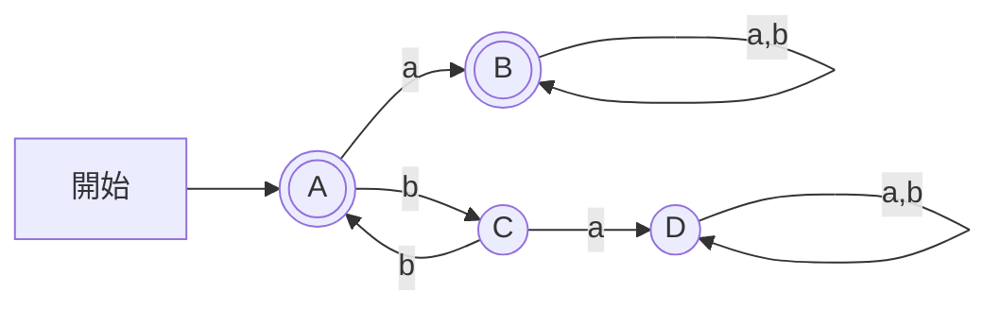

# 東京工業大学 情報理工学院 情報工学系 2018年8月実施 午前 2.

## **Author**
祭音Myyura (co-authored with GPT 5.6 SOL)

## **Description**

以下の問いに答えよ。

### 1)

次の真理値表を完成させよ。

| $P$ | $Q$ | $R$ | $(\neg P\lor Q)\to(P\land R)$ |
| --- | --- | --- | --- |
| T | T | T | (a) |
| T | T | F | (b) |
| T | F | T | (c) |
| T | F | F | (d) |
| F | T | T | (e) |
| F | T | F | (f) |
| F | F | T | (g) |
| F | F | F | (h) |

### 2)

論理式 $P$ と論理式 $Q$ の NAND（否定論理積）を $P\mathbin{|}Q$ と表記する。$P\mathbin{|}Q$ は $P$ と $Q$ の論理積の否定であるため，その真理値表は $\neg(P\land Q)$ と等しい。多くの論理式は NAND のみで表現することが可能であり，例えば，$\neg P$ は $P\mathbin{|}P$ に，$P\lor Q$ は $(P\mathbin{|}P)\mathbin{|}(Q\mathbin{|}Q)$ と書き直すことができる。NAND のみを利用し，$P\to Q$ を書き直せ。

### 3)

次の表はチョムスキーの分類による文法，文法の生成規則の例，その文法から生成された言語を認識する計算モデルの関係を示したものである。下の表中の (a)～(h) に対応する用語を用語群から選択し回答せよ。ただし，用語群の用語は一度しか使用できないものとする。

| 文法分類 | 文法 | 生成規則の例 | 計算モデル |
| --- | --- | --- | --- |
| 0型文法 | 句構造文法 | (c) | (f) |
| 1型文法 | (a) | $bS\to bb$ | 線形有界オートマトン※ |
| 2型文法 | 文脈自由文法 | (d) | (g) |
| 3型文法 | (b) | (e) | (h) |

用語群：

- (ア) 文脈依存文法
- (イ) 正規文法
- (ウ) 接辞文法
- (エ) $S\to aSa$
- (オ) $S\to aA$
- (カ) $AS\to b$
- (キ) チューリングマシン
- (ク) プッシュダウン・オートマトン
- (ケ) 有限オートマトン

※線形有界オートマトン (linear bounded automaton) は線形拘束オートマトンと訳される場合もある。

### 4)

次に示す非決定性有限オートマトン $(Q,\Sigma,\delta,q_1,F)$ を考える。ここで，状態の集合 $Q=\{q_1,q_2\}$，アルファベット $\Sigma=\{a,b\}$，受理状態の集合 $F=\{q_1\}$ であり，初期状態は $q_1$ とする。また，$\delta$ は遷移関数を意味するものとする。

a) 次の文字列ア)～キ) のうち受理するものの記号をすべて答えよ。

ア) `ab`　イ) `abbb`　ウ) `bbba`　エ) `aaab`　オ) `aaabba`　カ) `bbabb`　キ) `aabaa`

b) この非決定性有限オートマトンが受理する言語の正規表現を与えよ。ただし，選択には $+$，Kleene 閉包には $*$ の記号を用い，連接を表現する記号は省略して良い。

c) この非決定性有限オートマトンと等価な決定性有限オートマトンを構成せよ。

#### 题目描述

回答下列问题。

**1)** 完成下列真值表。

| $P$ | $Q$ | $R$ | $(\neg P\lor Q)\to(P\land R)$ |
| --- | --- | --- | --- |
| T | T | T | (a) |
| T | T | F | (b) |
| T | F | T | (c) |
| T | F | F | (d) |
| F | T | T | (e) |
| F | T | F | (f) |
| F | F | T | (g) |
| F | F | F | (h) |

**2)** 将逻辑式 $P$ 与逻辑式 $Q$ 的 NAND（与非）记为 $P\mathbin{|}Q$。因为 $P\mathbin{|}Q$ 是 $P$ 与 $Q$ 的合取的否定，其真值表与 $\neg(P\land Q)$ 相同。许多逻辑式可以仅用 NAND 表示，例如 $\neg P$ 可以改写为 $P\mathbin{|}P$，$P\lor Q$ 可以改写为 $(P\mathbin{|}P)\mathbin{|}(Q\mathbin{|}Q)$。只使用 NAND 改写 $P\to Q$。

**3)** 下表给出了乔姆斯基层次中的文法、文法产生式的例子，以及识别该文法生成的语言的计算模型之间的关系。从术语组选出表中 (a)～(h) 对应的术语。术语组中的每个术语只能使用一次。

| 文法分类 | 文法 | 产生式的例子 | 计算模型 |
| --- | --- | --- | --- |
| 0型文法 | 短语结构文法 | (c) | (f) |
| 1型文法 | (a) | $bS\to bb$ | 线性有界自动机※ |
| 2型文法 | 上下文无关文法 | (d) | (g) |
| 3型文法 | (b) | (e) | (h) |

术语组：

- (ア) 上下文有关文法
- (イ) 正则文法
- (ウ) 词缀文法
- (エ) $S\to aSa$
- (オ) $S\to aA$
- (カ) $AS\to b$
- (キ) 图灵机
- (ク) 下推自动机
- (ケ) 有限自动机

※线性有界自动机 (linear bounded automaton) 在日语中也译作「線形拘束オートマトン」。

**4)** 考虑上图所示的非确定性有限自动机 $(Q,\Sigma,\delta,q_1,F)$。状态集合为 $Q=\{q_1,q_2\}$，字母表为 $\Sigma=\{a,b\}$，接受状态集合为 $F=\{q_1\}$，初始状态为 $q_1$。$\delta$ 表示转移函数。

a) 从下列字符串ア)～キ) 中，写出所有被该自动机接受的字符串的符号。

ア) `ab`　イ) `abbb`　ウ) `bbba`　エ) `aaab`　オ) `aaabba`　カ) `bbabb`　キ) `aabaa`

b) 给出该非确定性有限自动机所接受语言的正则表达式。选择运算使用 $+$，Kleene 闭包使用 $*$，连接运算的符号可以省略。

c) 构造与该非确定性有限自动机等价的确定性有限自动机。

## **Kai**

### 1)

$$
 (\neg P\lor Q)\to(P\land R)
= (P\land\neg Q)\lor(P\land R)=P\land(\neg Q\lor R). 
$$

従って (a)〜(h) は順に $\boxed{T,F,T,T,F,F,F,F}$。

### 2)

$$
\boxed{P\mathbin{|}(Q\mathbin{|}Q)}=\neg(P\land\neg Q)=P\to Q.
$$

### 3)

| 空欄 | 解答 |
|---|---|
| a | 文脈依存文法（ア） |
| b | 正規文法（イ） |
| c | $AS\to b$（カ） |
| d | $S\to aSa$（エ） |
| e | $S\to aA$（オ） |
| f | チューリングマシン（キ） |
| g | プッシュダウン・オートマトン（ク） |
| h | 有限オートマトン（ケ） |

### 4)

#### a)

$\boxed{\text{ア、イ、エ、オ、カ、キ}}$。

#### b)

$q_1$ から $q_1$ に戻る基本経路のラベルは $a,ab,bb$。従って

$$
\boxed{(a+ab+bb)^*}.
$$

#### c)

$A=\{q_1\}$、$B=\{q_1,q_2\}$、$C=\{q_2\}$、$D=\varnothing$ とする。初期状態は $A$、受理集合は $\{A,B\}$。

| 状態 | a | b |
|---|---|---|
| $A$ | $B$ | $C$ |
| $B$ | $B$ | $B$ |
| $C$ | $D$ | $A$ |
| $D$ | $D$ | $D$ |

