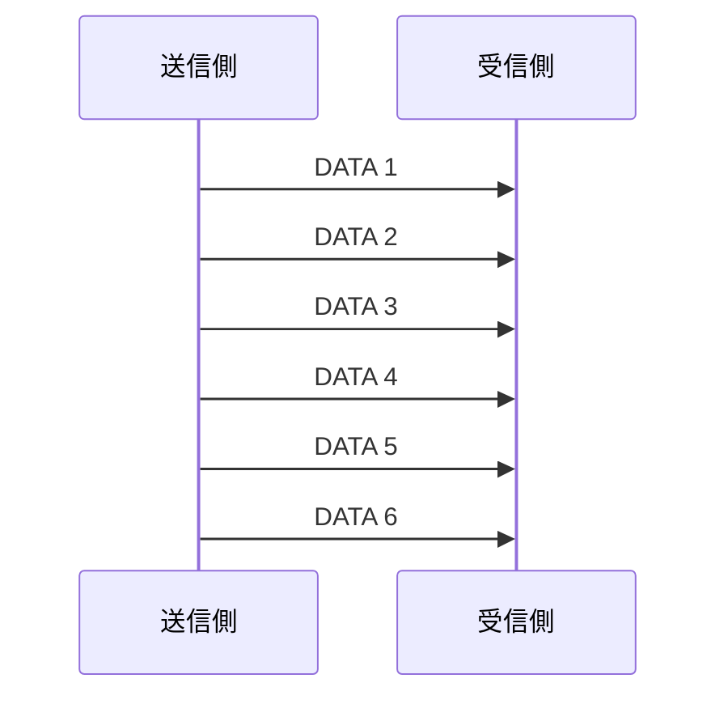

# 大阪大学 情報科学研究科 情報工学 2016年7月実施 ネットワーク

## **Author**
祭音Myyura (co-authored with GPT 5.6 SOL)

## **Description**

**【選択問題】ネットワーク**

配点：(1-1-1) 5点，(1-1-2) 14点，(1-2) 21点，(2-1) 18点，(2-2-1) 10点，(2-2-2) 10点，(2-2-3) 15点，(2-3) 32点

(1) 記憶がない情報源 (memoryless information source) の2元ハフマン符号化 (binary Huffman coding) について考える。

(1-1) 情報源記号が $a,b$，各記号の生起確率 (occurrence probability) が $p(a)=0.8,p(b)=0.2$ である情報源 $S_0$ を考える。以下では通信路記号を0，1とし，2元ハフマン符号化の復号木 (decoding tree) における通信路記号の割り当ては一通りだけを示せばよい。なお，復号木は符号の木 (code tree) とも呼ばれている。

(1-1-1) 情報源 $S_0$ の2元ハフマン符号化の復号木および平均符号語長 (average code length) を書け。

(1-1-2) 情報源 $S_0$ の記号を2個ずつまとめて出力する情報源，すなわち $S_0$ の2次拡大 (second extension) $S_0^2$ を考える。記号列 $aa,ab,ba,bb$ それぞれの生起確率を求めよ。また，$S_0^2$ の2元ハフマン符号化のすべての復号木と，情報源記号1個あたりの平均符号語長を求めよ。

(1-2) 一般の記憶がない情報源 $S$ の $n$ 次拡大 ($n$-th extension) $S^n$ について考える。以下では，$S^n$ の2元ハフマン符号化の，情報源記号1個あたりの平均符号語長を $l_n$ とする。以下の文章の空欄（あ）〜（う）を埋めよ。

情報源 $S$ の2を底とするエントロピー (entropy) を $H(S)$ とするとき，拡大情報源 $S^n$ のエントロピーは $\boxed{\text{あ}}$ である。また，シャノンの情報源符号化定理 (Shannon's source coding theorem，シャノンの第一定理ともいう) から，

$$
H(S)\le l_n<H(S)+\boxed{\text{い}}
$$

が成り立つ。この式を用いると，拡大情報源の情報源記号1個あたりの平均符号語長に関する以下の議論が成立する。今，ある正の整数 $n_0$ について，$l_{n_0}$ が $H(S)$ に等しくないとする。すなわち，ある $\delta>0$ を用いて $l_{n_0}=H(S)+\delta$ と表せるとする。このとき，$n\ge\boxed{\text{う}}$ を満たすように $n$ を選べば，$l_n$ は $l_{n_0}$ よりも必ず小さくなる。

(2) トランスポート層プロトコル (transport layer protocol) についての以下の各小問に答えよ。

(2-1) トランスポート層プロトコルが用いるフロー制御 (flow control)，ふくそう制御 (congestion control)，および再送制御 (retransmission control) に関する以下の文章の空欄（あ）〜（か）に当てはまる最も適切な語句を選択肢から選び，その記号を答えよ。なお，異なる空欄には異なる語句が当てはまる。

フロー制御は，送信側ホストと受信側ホストの $\boxed{\text{あ}}$ や $\boxed{\text{い}}$ などの違いを考慮し，$\boxed{\text{う}}$ を決定するための制御である。ふくそう制御は，ネットワークが $\boxed{\text{え}}$ になることで，ネットワーク内で発生するセグメントの廃棄や $\boxed{\text{お}}$ の増加を防止し，ふくそう状態から回復するために，$\boxed{\text{う}}$ を決定するための制御である。再送制御は，再送タイマ (retransmission timer) 等を利用し，ネットワーク内でのセグメントの $\boxed{\text{か}}$ を検出し，再送を行うための制御である。

選択肢：

| 記号 | 語句 | 記号 | 語句 |
|---|---|---|---|
| (a) | セグメントサイズ (segment size) | (g) | IPアドレス (IP address) |
| (b) | データ転送速度 (data transmission speed) | (h) | 喪失 (loss) |
| (c) | 過負荷 (overload) | (i) | メモリサイズ (memory size) |
| (d) | 転送遅延 (transmission latency) | (j) | ポート番号 (port number) |
| (e) | 経路 (route) | (k) | スループット (throughput) |
| (f) | ループ (loop) | (l) | 処理速度 (processing speed) |

(2-2) 以下の図は，代表的なフロー制御手法であるストップアンドウェイトフロー制御 (stop and wait flow control) を用いたデータ転送の様子を表している。図中の矢印はセグメントの送信を意味し，DATA はデータセグメント (data segment) を，ACK は確認応答セグメント (acknowledgement segment) をそれぞれ表す。なお，ここでは，セグメントの喪失は発生しないものとする。


(2-2-1) データセグメントが $P$ [バイト] のデータと $H$ [バイト] のヘッダから構成されるものとする。また，データセグメントをネットワーク層に受け渡してから，対応する確認応答セグメントをネットワーク層から受け取るまでの時間である，ラウンドトリップ時間 (round trip time) の平均値を $T$ [秒] とする。上図における，データ転送の平均スループット (average throughput) [ビット/秒] を答えよ。

(2-2-2) (2-2-1) の結果を用いて，データ転送のスループットの観点から，ストップアンドウェイトフロー制御の問題点を説明せよ。

(2-2-3) ストップアンドウェイトフロー制御に比べてデータ転送のスループットを向上することができるフロー制御の一つである，スライディングウィンドウフロー制御 (sliding window flow control) を用いたデータ転送の様子を，上図と同様の方法で示せ。なお，ウィンドウサイズを3 [セグメント] とし，データ転送の様子のみ解答すること。

(2-3) データセグメントの送信時に作動させる再送タイマの設定値が大きすぎる場合，および小さすぎる場合に発生する問題点をそれぞれ述べよ。また，再送タイマの設定値を適切に決定するために，TCP (Transmission Control Protocol) の一般的な実装 (implementation) において用いられている手法を説明せよ。

#### 题目描述

**【选答题】网络**

分值：(1-1-1) 5分，(1-1-2) 14分，(1-2) 21分，(2-1) 18分，(2-2-1) 10分，(2-2-2) 10分，(2-2-3) 15分，(2-3) 32分

(1) 考虑无记忆信源的二元 Huffman 编码。

(1-1) 信源 $S_0$ 的符号为 $a,b$，各符号的发生概率为 $p(a)=0.8,p(b)=0.2$。以下取信道符号为0、1；对二元 Huffman 译码树，只需给出一种信道符号分配。译码树也称为码树。

(1-1-1) 画出信源 $S_0$ 的二元 Huffman 译码树，并写出平均码长。

(1-1-2) 将 $S_0$ 的符号每两个合成一组输出，得到其二次扩展信源 $S_0^2$。求符号序列 $aa,ab,ba,bb$ 各自的发生概率，并求 $S_0^2$ 的全部二元 Huffman 译码树，以及每个原信源符号的平均码长。

(1-2) 考虑一般无记忆信源 $S$ 的 $n$ 次扩展 $S^n$。记 $S^n$ 的二元 Huffman 编码中，每个原信源符号的平均码长为 $l_n$。填写下文空格（あ）至（う）。

设信源 $S$ 以2为底的熵为 $H(S)$，则扩展信源 $S^n$ 的熵为 $\boxed{\text{あ}}$。由 Shannon 信源编码定理（也称 Shannon 第一定理），有

$$
H(S)\le l_n<H(S)+\boxed{\text{い}}.
$$

由此可得以下关于扩展信源每个原信源符号平均码长的结论。假设存在正整数 $n_0$，使 $l_{n_0}$ 不等于 $H(S)$，即存在 $\delta>0$ 使 $l_{n_0}=H(S)+\delta$。此时，只要选择满足 $n\ge\boxed{\text{う}}$ 的 $n$，便一定有 $l_n<l_{n_0}$。

(2) 回答以下有关传输层协议的问题。

(2-1) 对下文关于传输层协议使用的流量控制、拥塞控制和重传控制的说明，分别从选项中选择最合适的词语填入（あ）至（か），回答其符号。不同空格应填入不同的词语。

流量控制考虑发送方与接收方主机在 $\boxed{\text{あ}}$、$\boxed{\text{い}}$ 等方面的差异，据此决定 $\boxed{\text{う}}$。拥塞控制为了防止网络 $\boxed{\text{え}}$ 导致网络内的报文段丢弃及 $\boxed{\text{お}}$ 增加，并使网络从拥塞状态恢复，决定 $\boxed{\text{う}}$。重传控制利用重传计时器等，检测网络中报文段的 $\boxed{\text{か}}$ 并进行重传。

选项：

| 符号 | 词语 | 符号 | 词语 |
|---|---|---|---|
| (a) | 报文段大小 | (g) | IP地址 |
| (b) | 数据传输速度 | (h) | 丢失 |
| (c) | 过载 | (i) | 内存大小 |
| (d) | 传输时延 | (j) | 端口号 |
| (e) | 路径 | (k) | 吞吐量 |
| (f) | 环路 | (l) | 处理速度 |

(2-2) 下图表示使用典型流量控制方式——停止等待流量控制进行数据传输的过程。箭头表示发送报文段；DATA 表示数据报文段，ACK 表示确认应答报文段。假设报文段不会丢失。


(2-2-1) 设数据报文段由 $P$ 字节的数据和 $H$ 字节的头部组成。从将数据报文段交给网络层开始，到从网络层收到对应的确认应答报文段为止的时间，称为往返时间；其平均值为 $T$ 秒。求图中数据传输的平均吞吐量，单位为比特/秒。

(2-2-2) 利用 (2-2-1) 的结果，从数据传输吞吐量的角度说明停止等待流量控制的问题。

(2-2-3) 滑动窗口流量控制能够提高相较于停止等待方式的数据传输吞吐量。请用与上图相同的方式，画出采用滑动窗口流量控制的数据传输过程。窗口大小设为3个报文段，只需画出数据传输过程。

(2-3) 分别说明在发送数据报文段时启动的重传计时器，设置值过大或过小时会发生什么问题，并说明 TCP 的一般实现如何适当确定重传计时器的设置值。

## **Kai**

### (1)

#### (1-1-1)

一例として $a\mapsto0, b\mapsto1$ とする。

```text
(root)
├─0→ a
└─1→ b
```

$$
\boxed{\bar L=0.8\cdot1+0.2\cdot1=1}.
$$

#### (1-1-2)

$$
P(aa)=0.64,\quad P(ab)=P(ba)=0.16,\quad P(bb)=0.04.
$$

各分岐の左右（0と1）の交換を同一視すると、同率の $ab,ba$ のどちらを $bb$ と先に併合するかにより、復号木は次の2通りである。各木の3個の内部節点で左右を独立に交換したものもハフマン復号木であり、0/1の割当てまで区別すれば $2\cdot2^3=16$ 通りとなる。

```text
木1: aa=0, ab=10, ba=110, bb=111
木2: aa=0, ba=10, ab=110, bb=111
```

符号語対1個当たりの平均長は

$$
0.64\cdot1+0.16\cdot2+0.16\cdot3+0.04\cdot3=1.56.
$$

したがって情報源記号1個当たりでは

$$
\boxed{\bar L_2=1.56/2=0.78}.
$$

#### (1-2)

$$
\boxed{(\text{あ})=nH(S)},\qquad
\boxed{(\text{い})=\frac1n},\qquad
\boxed{(\text{う})=\frac1\delta}.
$$

実際、$H(S)\le l_n<H(S)+1/n$ であり、$n\ge1/\delta$ なら

$$
l_n<H(S)+\frac1n\le H(S)+\delta=l_{n_0}.
$$

### (2)

#### (2-1)

$$
\boxed{\begin{gathered}
(\text{あ}),(\text{い})=(i),(l)\quad\text{（順不同）},\\
(\text{う})=(b),\quad (\text{え})=(c),\\
(\text{お})=(d),\quad (\text{か})=(h).
\end{gathered}}
$$

#### (2-2-1)

1 RTTごとに1個、すなわち $8(P+H)$ bitのデータセグメントを転送するので

$$
\boxed{\frac{8(P+H)}{T}\ \mathrm{bit/s}}.
$$

#### (2-2-2)

ACKを受信するまで次のデータセグメントを送れないため、伝送路が空く時間が生じる。特にRTTが大きいとリンク帯域を十分利用できず、スループットが低下する。

#### (2-2-3)



ACKの矢印は設問の指示に従い省略した。DATA 1～3を連続送信し、各ACKの受信で送信窓を1セグメントずつ進めてDATA 4、5、6を送る。

#### (2-3)

設定値が大きすぎると、セグメント喪失後の再送が遅れ、スループットが低下する。小さすぎると、セグメントまたはACKが到着する前にタイムアウトし、不要な再送とふくそう制御を生じる。

TCPではRTT標本から平滑化RTTとRTT偏差を更新し、例えば

$$
\boxed{\mathrm{RTO}=\mathrm{SRTT}+4\,\mathrm{RTTVAR}}
$$

として適応的に設定する。連続タイムアウト時には指数バックオフを行う。

## **Reference**

- [大阪大学公式問題集（PDF 72–73ページ）](https://www.ist.osaka-u.ac.jp/files/examinees/admission/past-exam/5_Ingormation_engineering_sample_2023_JA.pdf#page=72)
